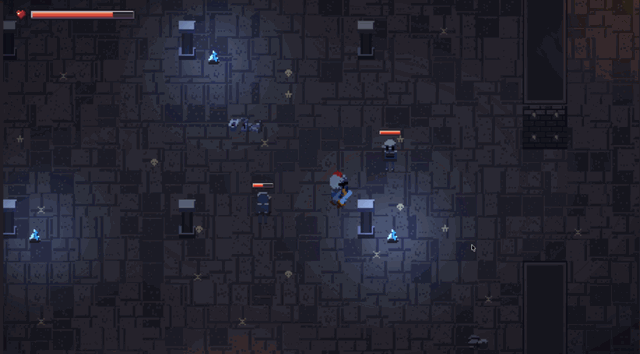

# Isometric2DGame

Isometric 2D prototype for the Runic Dices Entertainment programming trial. Specialization: Combat.



## Run
Unity 6000.4.1f1, no extra setup. Open the project, open `Assets/_Project/Scenes/Game.unity`, press Play.

## Controls
- Move: WASD, arrows or left stick
- Sword: Space, Enter, left mouse button or gamepad west button
- Fireball: casts on its own

## How to test
The knight starts in a quiet room with no enemies. The door in the top wall leads to the pillar hall, the door on the right to the arena. The hall and the arena are connected, so the level is a loop.

**Task 2, movement and camera**
- W is up on the screen, diagonal speed equals straight speed.
- `Data/Player/PlayerMoveConfig.asset`: change `Max Speed` in Play mode, turn off `Instant Acceleration` for a smooth ramp.
- The collider is at the feet: the knight slides along walls and stands right against them. Walk around a pillar to see Y-sorting.
- Four-direction idle and walk. Cinemachine camera follows without jitter and stays inside the map.

**Task 3, enemy AI**
- Select a skeleton in Play mode for its gizmos: yellow detect, grey lose, red attack. Select `SpawnPoints/Spawn_N` for its route.
- Patrol: waypoint routes cross a room, area routes pick random reachable points.
- Chase: step into the yellow circle. Skeletons see only in a straight line, hide behind a pillar and they lose you.
- Search: break line of sight. The skeleton walks to where it last saw you, looks around, then returns to patrol.
- Attack: it stops at range, faces you and swings. Lose radius and attack exit range are larger than detect and attack range, so it does not flicker between states.

**Task 4, combat**
- Sword: the hit lands mid-swing, every skeleton in the circle is hit once per swing. Skeleton 10 HP, sword 3.
- Fireball: every 1.5 s at the nearest visible skeleton in range, 1 damage, pooled. It does not cast through pillars.
- Hit reactions: red flash, knockback, hurt animation, the skeleton's attack is cancelled. The knight also shakes the camera and is invulnerable for a moment after a hit.
- Knight's health bar in the top left corner, a small bar over every skeleton. Knight 10 HP, a skeleton hit deals 2.
- At 0 HP the knight dies, Game Over shows a second later, Restart reloads the scene.

**Enemy spawner and polish**
- Four skeletons spawn at the start, then one every 4 s up to 8 alive, never closer than 5 units to the knight.
- A dead body disappears after 3 s and the object goes back to the pool for the next spawn.
- Each zone has its own light (warm start, cold hall, hot arena), plus bloom and vignette.

**Tuning:** `Assets/_Project/Data/` holds every config: player movement and combat, enemy behaviour, spawner. Most values are read on start, restart Play mode after changing them.

## Architecture
```
Assets/_Project/Scripts/
  MainCharacter/  Player and its parts: input, melee attack, hit reaction
  EnemyCharacter/ Enemy, states, patrol routes, player sensor, spawner
  StateMachines/  generic state machine with a transition table
  Combat/         health, damage, target query, projectiles
  Movement/       CharacterMotor and velocity modifiers
  Core/           GameController: spawner, HUD, Game Over
```
- `Player` and `Enemy` are thin MonoBehaviours. They build plain C# parts in `Awake` and reset them in `OnEnable`, which is also what pooling needs.
- Enemy AI is a state machine with a transition table: states never switch themselves, all transitions are in one method of `Enemy`.
- One damage path: every hit calls `IDamageable.TakeDamage`, `Health` raises events, flash, shake, bars and hurt reactions subscribe.
- Hits are physics queries at the hit moment, not weapon colliders. Swing timing is shared by the knight and the skeleton.
- Speed changes and knockback are velocity modifiers on `CharacterMotor`, so they stack without knowing about each other.
- Skeletons come from one pool. `Enemy` raises `CorpseExpired` and does not know about pooling.

All decisions with reasons: [docs/PLAN.md](docs/PLAN.md#decisions).

## Estimate vs actual
About 29 hours against an estimate of 25. Combat took about 9 hours instead of 5: it had the longest list of the four tasks and the same estimate as the enemy AI. Details in [docs/PLAN.md](docs/PLAN.md#estimates).

## Assets
- [Voxel Dungeon Pack](https://colefoster.itch.io/voxel-dungeon-pack), [Voxel Crypt Pack](https://colefoster.itch.io/voxel-crypt-pack) and [Hearthmark: Pixel RPG UI](https://colefoster.itch.io/hearthmark-rpg-ui) by Cole Foster, CC0 1.0. Licenses are in `Assets/_Project/Art/ThirdParty/ColeFoster/`. According to the pack README, the sprites are rendered by a generator whose code was written with AI coding agents; no image-generation model was used.

## AI usage
I discussed architecture with AI and used it for research, code review and git housekeeping. All gameplay code was written by me. Editor tooling, sprite import settings, animation clips, prefabs, the UI layout, the test level with spawn points, and the lighting and post-processing were set up with AI assistance.
