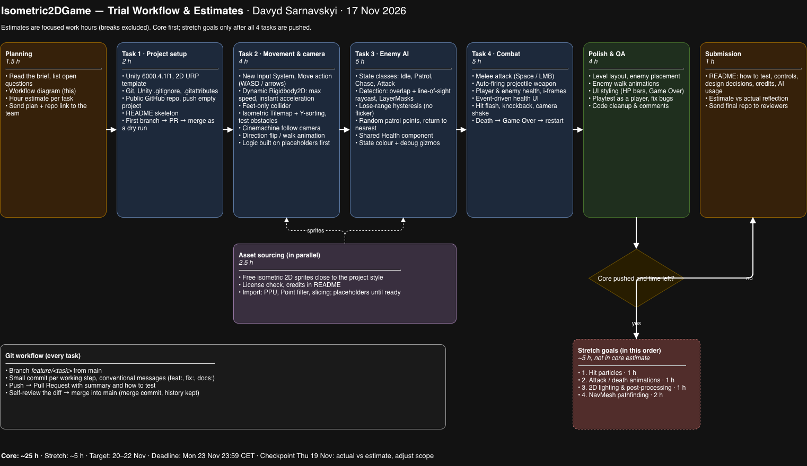

# Plan

Core features first. Stretch goals start only after all four tasks are merged into `main`.
Estimates are focused work hours, breaks not included.

## Estimates

| Block | Estimate |
|---|---|
| Planning | 1.5 h |
| Asset sourcing | 2.5 h |
| Task 1 - Project setup | 2 h |
| Task 2 - Movement and camera | 4 h |
| Task 3 - Enemy AI | 5 h |
| Task 4 - Combat | 5 h |
| Polish and QA | 4 h |
| Submission | 1 h |
| **Core total** | **25 h** |
| Stretch goals | ~5 h |

## Tasks

**Planning**
- Read the brief, note open questions
- Workflow diagram and estimates
- Send the plan and repository link

**Asset sourcing** (runs alongside Tasks 2-3, placeholders until it is done)
- Free isometric 2D sprites close to the project style
- License check, credits in README
- Import settings and slicing

**Task 1 - Project setup**
- Unity 6000.4.1f1, 2D URP template
- Git, Unity `.gitignore`, `.gitattributes`
- Public GitHub repository, empty project pushed
- README skeleton

**Task 2 - Movement and camera**
- New Input System, Move action for WASD and arrow keys
- Dynamic Rigidbody2D movement with configurable max speed and instant acceleration
- Player collider
- Isometric Tilemap with Y-sorting and test obstacles
- Cinemachine follow camera
- Direction flip or walk animation

**Task 3 - Enemy AI**
- State machine: Idle, Patrol, Chase, Attack
- Player detection with LayerMasks and line of sight
- Random patrol points
- Health component shared with the player
- State shown by colour, debug gizmos in the editor

**Task 4 - Combat**
- Melee attack on Space / left mouse button
- Auto-firing projectile weapon
- Player and enemy health
- Health UI
- Hit flash, knockback, camera shake
- Death, Game Over screen, restart

**Polish and QA**
- Level layout and enemy placement
- Enemy animations
- UI styling
- Playtest as a player, fix what feels wrong
- Code cleanup and comments

**Submission**
- README: how to test, controls, decisions, credits, AI usage
- Estimate vs actual
- Send the final repository

## Stretch goals (in this order)

1. Hit particles - 1 h
2. Attack and death animations - 1 h
3. 2D lighting and post-processing - 1 h
4. NavMesh pathfinding for enemies - 2 h

## Decisions

Added as they are made.
